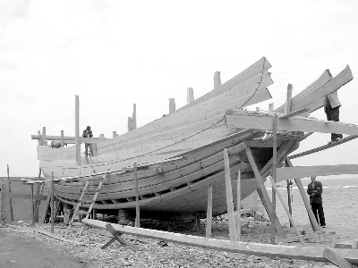
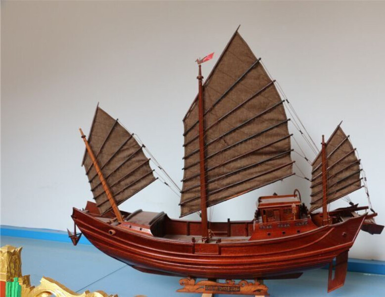

# 传统福船图片检索与供审阅清单 · 2026-10-25

**本轮未制作PPT；新增可推荐大幅展示的传统高清照片为0张。** 以下3张是已取回、逐张检查的追索线索，均未通过本轮高清筛选，也没有替代进PPT。图片预览按其实际像素提供，不能把小图预览当成高清原片。

本轮从中国非遗网检索到53条“福船”记录，重点读取了福船项目介绍、相关报道和陈芳财、刘细秀、黄宗财的国家级传承人名录。对取回的网页配图实测像素，并区分实船、在建木船、模型、节目展示和不相关海报。

## 图片清单

| 编号与预览 | 实测像素 | 实际内容及核验结果 | 许可与采用状态 |
|---|---|---|---|
| [C01 刘细秀展示福船模型](previews/C01.png) | 699×462 | 官方图注明确姓名与展示内容；人物的国家级传承人身份可另据名录核对。是节目中的模型展示，不是实船建造或艌缝现场 | 央视供图，摄影者未标明；未见开放许可。仅作索取原片线索，不能替代大幅建造照片 |
| [C02 支架上的在建木船](previews/C02.png) | 400×300 | 图片来自福船专题报道，但没有独立图注、船名、人物、地点和工序资料。不能据文章标题把它定为艌缝现场 | 原文注明光明网、稿件作者舒然；未单列摄影者或图片许可。像素与身份信息均不足，排除 |
| [C03 三桅船模配图](previews/C03.png) | 778×600 | 实际是带底座的船模，不是实船。馆藏身份、模型名称和具体船型无独立图注；不能替代建造/隔舱现场 | 文旅中国客户端文章、作者杨晓君；原文标注“图片来源网络”。源头及开放许可不明，不采纳为正式大图 |

### C01：身份已确认，但尺寸不足

- [来源网页：中国非遗网转载《中国文化报》报道](https://www.ihchina.cn/news_1_details/18813.html)，网页日期2019-06-12；该日期不等于拍摄日期。
- [网页发布的图片文件](https://www.ihchina.cn/Uploads/Picture/2019/06/12/s5d00a8cc27a45.jpg)。
- 图注明确写为：水密隔舱福船制造技艺国家级非遗代表性项目代表性传承人刘细秀展示福船模型（央视供图）。
- [国家级传承人名录：刘细秀，05-2835，项目Ⅷ-138](https://www.ihchina.cn/ccr_detail/3415.html)。人物身份由文字和图注核对，未靠人脸猜测。
- 准确文字可以是“刘细秀展示福船模型”；不能写“刘细秀正在艌缝”“船厂福船建造现场”。原图699像素宽，未作放大。
- 稿件作者赵若姝不是已确认的摄影者。供图单位为央视，未见CC或公有领域授权；参见下方版权说明。

### C02：报道相关，照片身份资料不足

- [来源网页：《水密隔舱福船：流传千年的造船技艺》](https://www.ihchina.cn/news_1_details/10729.html)，网页日期2010-11-24。
- [网页发布的图片文件](https://www.ihchina.cn/openbase/uploadfiles/201001124131654119.jpg)。
- 画面可见支架与在建木质船体；无法确认船名、拍摄地点、人员姓名及具体操作。不是可确认的艌缝特写。
- 稿件注明来源光明网、作者舒然，未说明摄影者。400×300只能作寻找原片的线索；不能用于课堂大幅投影，也不将其改称“已核实福船艌缝照片”。

### C03：模型图片，不能当成实船

- [来源网页：水密隔舱福船制造技艺专题](https://www.ihchina.cn/news_1_details/22407.html)，网页日期2021-02-01。
- [网页发布的图片文件](https://www.ihchina.cn/Uploads/Picture/2021/02/01/s601775d32485b.png)。
- 图中是模型，底座可见；不能以此说明实船隔舱结构或造船工序。文章主题不等于具体图片的船型鉴定。
- 原文为文旅中国客户端稿件，作者杨晓君；文末统一注明“图片来源网络”，未给原始摄影者、馆藏身份和开放许可。该图仅保留为核验记录。

## 进一步排除的图片

- 非遗网2023年劳动节报道中的800×936造船拼图：[来源页](https://www.ihchina.cn/news_1_details/27209.html)。多幅子图内容不同，不能把整张拼图或所有木船都称为已核实的福船。也没有可确认的艌缝操作。
- 《非遗里的中国》相关报道中，福船段落附近的一张450×857配图实际为戏曲宣传海报：[来源页](https://www.ihchina.cn/news_1_details/27151.html)。已目视排除，不依文字相邻关系判断图片内容。
- 另一张690×460节目画面显示人物与福船模型：[来源页](https://www.ihchina.cn/news_1_details/27167.html)。不是建造实景，未凭外观推断人物姓名，也未提升为高清候选。
- 开放许可图片检索所得其他中国帆船、其他船型、历史绘画或身份不明的模型，未冒称福船建造或艌缝工艺。此前“太平公主号”两张4256×2832候选继续维持待核实状态，没有因为分辨率高而降低船型核验标准。

## 为什么尚未取得合格高清原图

1. 已取回的相关网页配图仅400—801像素宽，实际文件没有达到优先1920像素的标准；没有用插值、AI或搜索缩略图放大补足。
2. 追溯到稿件原发站《中国文化报》`www.ccdy.cn`、光明网`www.gmw.cn`时，当前环境均返回`Tunnel connection failed: 403 Forbidden`，无法继续核对是否存有更大原片。
3. 本轮中国航海博物馆官网`www.shmmc.com.cn`返回503；福建省政府和拟查询的泉州海交馆入口分别返回403。被拦截的页面未读到正文，因此没有虚构馆方照片或授权。
4. UNESCO的07615高清图接口仍返回503。其他访问失败与检索索引分别见 [访问记录](sources/access-failures.json) 和 [53条检索结果索引](sources/search-index.json)。
5. 本轮更新了环境网络配置草稿，保留旧域名并加入`www.ccdy.cn`、`www.gmw.cn`、`www.fujian.gov.cn`、`www.qzhjg.cn`。工具确认保存且返回`requires_publish=true`；草稿尚未生效。发布可继续申请访问被403阻断的来源，但不能保证原站有高清文件，也不能解决站点自身503或取得图片授权。

这里的结论仅限“当前环境已能取回并核验的图片”，不是断言互联网上不存在高清福船照片。

## 可追索原片的明确身份线索

| 已核实人物/单位 | 依据 | 可追索内容；尚未取得 |
|---|---|---|
| 刘细秀，国家级传承人05-2835 | [名录](https://www.ihchina.cn/ccr_detail/3415.html) | 漳湾造船相关的具名照片、C01央视供图的高分辨率摄影文件及使用条件 |
| 陈芳财，国家级传承人03-1403；晋江市文化馆为项目保护单位 | [人物名录](https://www.ihchina.cn/ccr_detail/3151.html) · [项目及保护单位](https://www.ihchina.cn/project_details/14574.html) | 身份明确的福船建造、船体与工匠原片，以及摄影说明和许可 |
| 黄宗财，国家级传承人05-2836；泉州市泉港区文化馆为项目保护单位 | [人物名录](https://www.ihchina.cn/ccr_detail/3416.html) · [项目及保护单位](https://www.ihchina.cn/project_details/14576.html) | 身份明确的福船实物、建造与传承活动原片；不能将名录文字当成已取得照片 |

原片若能取得，仍须逐张记录船只/人物身份、拍摄地点、日期、工序、摄影者、像素及许可。普通木船施工不能自动改称福船艌缝。

## 使用许可

已读取[中国非遗网《版权与免责声明》](https://www.ihchina.cn/about/206.html)。站点对作者署名、注明来源及内容修改有要求；转载的第三方图片仍须保留原供图来源。未发现本清单图片具有CC或公有领域许可，不宣称取得了开放授权或可自由再分发。C01央视供图、C02光明网转载、C03“图片来源网络”的权利状态分别记录在清单中。

预览仅用于本次素材审核。图片文件原样保留；PNG预览维持原始像素尺寸，不提升清晰度，不裁剪、调色或补画。没有把稿件作者冒认为摄影者。

## 既有素材与封面限制

- [现代船舶及洋山港素材](../material-wisdom-v3-samples/README.md)均保留；本轮没有替换、覆盖或另作复制选图。
- [既有封面保留清单](../material-wisdom-v3-samples/cover-reservations.json)保持不变；COSCO船舶照片继续封面专用。后续新选封面图也必须登记原始URL和图像身份，裁剪、调色、缩放仍视为同图，正文与后续12页均禁复用。
- 新增C01—C03没有分配页码，没有获准进入PPT。
- [保护检查](preservation-check.json)：原版15页、V2、V3素材包、现代船舶/洋山港照片和两个Skill的248个既有文件均未改变。

[下载本轮审阅包](fuchuan-candidate-review.zip) · [机器可读清单](candidate-register.json) · [文件校验记录](verification.json)。本轮只供检查线索与排除理由，待照片条件满足并确认后才继续V3三页样张。
