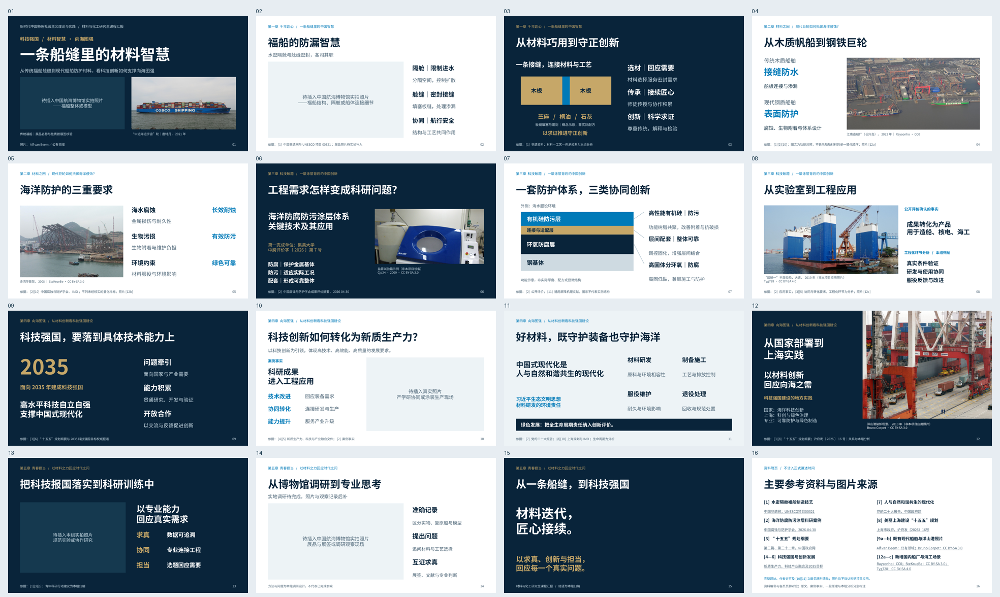

# 《一条船缝里的材料智慧》收尾清稿版

基于已确认的 `material-wisdom-photo-light.pptx` 收尾，**未重新设计、未全局减字、未增加页面**。保留16页（15页讲述＋1页参考资料）、五章结构、深海蓝配色、核心理论与科研事实，以及原16分30秒安排。

- [下载可编辑PPTX](build/material-wisdom-closeout.pptx?raw=1)：**23,256,392字节**。
- [下载PDF](build/material-wisdom-closeout.pdf?raw=1)：**3,004,814字节**。
- [下载16张逐页PNG与总览](material-wisdom-closeout-previews.zip?raw=1)：PNG为1920×1080。
- [下载完整交付包](material-wisdom-closeout-delivery.zip?raw=1)：以上文件、干净讲稿、图片出处、占位清单、源码及验证记录。
- [阅读逐页讲稿与必要资料依据](逐页讲稿.md)。
- [图片占位及替换说明](图片占位清单与替换说明.md)。

GitHub如提示文件太大无法预览，请点击 **Download raw file / Raw**。PPTX是原生可编辑文件，不需要运行脚本即可使用。

## 本轮实际完成

1. 清理16页演讲者备注中的JSON、旧版内容备份、编辑提示及开发记录，保留正常讲稿和必要出处。第14页讲稿与照片占位对应，不冒称已完成实地调研；第15页衔接当前结语。
2. 第6页在原有图片框内填入一张**真实盐雾试验箱**照片；原始2048×1536，Cjp24自摄，2009年4月，CC BY-SA 3.0。图注和讲稿均明确“非本项目设备”，不作为集美大学科研设备、实验结果或具体测试流程的证据。
3. 第10、13页未找到内容身份、清晰度与主题相关性都合适的照片，保留占位。没有用外国军舰、无关仪器或未核实的教学场景凑图。
4. 第1、2、14页博物馆照片保持空置，等待用户实拍。原有5张真实高清现代船舶、船厂、海工和洋山港照片全部保留，封面照片不复用。

新增图片来源：https://commons.wikimedia.org/wiki/File:Salt_spray_chamber.jpg  
许可：https://creativecommons.org/licenses/by-sa/3.0  
已下载原始JPEG，核对作者自摄标注、实际内容与相机EXIF。没有核实拍摄机构与国家，因此没有称为国内或本案例研发现场。图片在PowerPoint内等比裁剪，原始像素不改动。

检索限于第6/10/13页，11项定向查询、82条结果；筛选依据见[检索与选用记录](sources/closeout-photo-selection.json)。没有继续搜索传统福船照片，也没有重试已失败的网站。

## 尚待补充的照片

| 页码 | 建议内容 | 横向比例 |
|---|---|---|
| 1 | 中国航海博物馆：身份明确的福船整体或模型；封面独占 | 2:1 |
| 2 | 福船结构、隔舱或船体连接细节；独立原片 | 16:9 |
| 10 | 产学研协同、工艺验证或涂装生产现场 | 16:10 |
| 13 | 本组规范实验、原始记录或协作研究实拍 | 3:2 |
| 14 | 展品与展签或真实调研观察现场；独立原片 | 16:9 |

5处均保留PowerPoint原生图片占位符。通过占位符插图后，删除同名 `_LABEL` 提示文字即可；不要拉伸。展品名称与性质、地点、日期、摄影者和许可需据实补充。详细操作见[替换说明](图片占位清单与替换说明.md)。

## 预览



[前8页大图](build/previews/preview-01-08.png) · [后8页大图](build/previews/preview-09-16.png)

- [第01页PNG](build/previews/slide-01.png?raw=1)
- [第02页PNG](build/previews/slide-02.png?raw=1)
- [第03页PNG](build/previews/slide-03.png?raw=1)
- [第04页PNG](build/previews/slide-04.png?raw=1)
- [第05页PNG](build/previews/slide-05.png?raw=1)
- [第06页PNG](build/previews/slide-06.png?raw=1)
- [第07页PNG](build/previews/slide-07.png?raw=1)
- [第08页PNG](build/previews/slide-08.png?raw=1)
- [第09页PNG](build/previews/slide-09.png?raw=1)
- [第10页PNG](build/previews/slide-10.png?raw=1)
- [第11页PNG](build/previews/slide-11.png?raw=1)
- [第12页PNG](build/previews/slide-12.png?raw=1)
- [第13页PNG](build/previews/slide-13.png?raw=1)
- [第14页PNG](build/previews/slide-14.png?raw=1)
- [第15页PNG](build/previews/slide-15.png?raw=1)
- [第16页PNG](build/previews/slide-16.png?raw=1)

## 验证

- LibreOffice渲染全部16页，PDF16页，逐页PNG为1920×1080。PPTX ZIP/XML有效，PDF嵌入中文字体。
- 第6页仅填入原预留框内的照片与图注；其余15页不仅幻灯片XML相同，最终预览也与上一版逐像素完全相同。全套主体上屏文字没有继续删减。
- 原生可编辑文本对象200个，原始真实照片6张，未填的原生图片占位符5处；图片比例保持正确，封面未重复。
- 自动检查0溢出、0重叠、0几何错误、0视觉/设计/视觉复核警告。保留4条大幅占位或功能图面积密度的非阻塞提示；人工检查未见拥挤。
- 对5处空占位完成插图、保存、重新打开测试，测试只操作临时副本。没有在Windows/Mac PowerPoint人工操作验证。
- 幻灯片与备注中均无独立作业的相关内容；干净备注通过PPTX实际文本核对。
- 此前567个文件哈希不变，所有旧PPT、样张、素材及coursework-ppt均未覆盖。

详见 [完整性记录](build/integrity.json)、[视觉保持记录](build/visual-preservation.json)、[备注清理记录](notes-cleanup-report.json)和[最终检查说明](build/qa/manual-review.md)。

## 源码和文件使用

直接下载PPTX即可编辑。源内容为`outline.json`，干净讲稿与备注一致；生成使用仓库已有presentation-skill标准构建器。新图片与模板仅做当前框内替换适配，未重装依赖。

```bash
bash presentations/material-wisdom-closeout-20261026/rebuild.sh
```

重建需要本仓库及已安装Skill、Node.js/PptxGenJS、Python依赖、LibreOffice和Poppler。`source/`保留使用的模板与本轮集成补丁；依赖运行时不在交付ZIP内。

ZIP为避免重复，省略了已原样嵌入PPTX的单独JPEG和重复QA渲染JPG。单独原图仍在GitHub的`assets/`；也可用`python restore_photo_assets.py`按SHA-256从PPTX无损恢复，不需要重新下载或压缩照片。

**本轮完成后暂停修改，等待用户提供中国航海博物馆实拍照片，再另存新版本进行图片替换与排版检查。**
