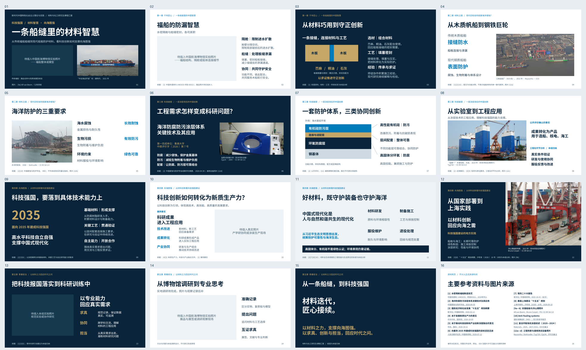

# 《一条船缝里的材料智慧》最终局部精修版

直接基于 `material-wisdom-closeout.pptx` 局部修改，保留**15页正式内容＋1页参考资料、五章结构、深海蓝风格、6张原始真实照片和5处图片占位**。所有旧文件保留。

- [下载可编辑PPTX](build/material-wisdom-final-local.pptx?raw=1)：**23,273,632字节**。
- [下载PDF](build/material-wisdom-final-local.pdf?raw=1)：**3,063,545字节**。
- [下载16张逐页PNG与总览](material-wisdom-final-local-previews.zip?raw=1)：全部1920×1080。
- [下载完整交付包](material-wisdom-final-local-delivery.zip?raw=1)：以上文件、讲稿、精确资料与图片清单、修改对照、源码和QA记录。
- [本轮实际修改清单](本轮实际修改清单.md)。
- [干净逐页讲稿与资料依据](逐页讲稿.md)。
- [完整参考资料与图片许可](参考资料与图片来源.md)。

GitHub提示文件过大无法预览时，点击 **Download raw file / Raw**。PPTX可直接在PowerPoint中编辑，无需运行生成脚本。

## 修改重点

| 页码 | 本轮变化 |
|---|---|
| 1 | 封面视觉保留，在备注用三个问题确立科技强国主线；照片脚注对应[9a]。 |
| 2—3 | 补足隔舱、艌缝的不同作用及协同关系，说明材料选择、填塞压实和工匠经验。 |
| 6—8 | 科研关键词后增加具体问题；保留真实评价编号与非项目设备标注；简化第7页上屏机理，并增加第8页章节过渡。 |
| 9—12 | 分别从材料基础与自主能力、成果转化与产业协同、生态责任、上海实际材料需求联系科研案例，避免政策堆叠。 |
| 13—14 | 青年担当落到记录追溯、跨学科工程交流和需求选题；第14页页面不变，讲稿强调模型观察不等于性能验证。 |
| 15 | 保留“材料迭代，匠心接续”，补充“以材料之力，支撑向海图强”。 |
| 16 | 展开12组资料，补具体文件名称、机构、日期，图片细项与前文编号对应；全文网址和DOI保留在备注与清单。 |

第4、5页保留原图和裁剪，没有用来源不明图片替换。第4页船身英文品牌和第12页岸桥标识/编号均为照片内容，不是PPT乱码。第6页盐雾试验箱仍为**通用设备示例，非集美大学项目设备或实验结果**；第8、12页工程照片也不作为项目应用证明。

科研案例全称、第一完成单位与编号已于2026-10-26在中国腐蚀与防护学会原页复核：**海洋防腐防污涂层体系关键技术及其应用；集美大学；中腐评价字〔2026〕第7号**。本轮不增加实验数据、国产替代率、长期寿命、减排结论或上海具体工程应用。

## 讲述时间

按**17分钟**准备，仍处于要求的16—18分钟内。15页讲稿正文约3947个汉字，平均约232字/分钟；参考资料页不安排正式讲述。封面40秒、第6页70秒、第10页85秒，其余页面原时间保留。实际用时需排练确认。

## 尚待补充的照片

| 页码 | 建议内容 | 横向比例 |
|---|---|---|
| 1 | 博物馆福船整体或模型，封面独占 | 2:1 |
| 2 | 福船结构、隔舱或船体连接细节 | 16:9 |
| 10 | 真实产学研协同或涂装生产场景 | 16:10 |
| 13 | 本组规范实验或协作研究实拍 | 3:2 |
| 14 | 博物馆展品与展签或真实调研观察现场 | 16:9 |

5处原生图片占位的尺寸、位置和裁剪比例均保持，补图后删除对应 `_LABEL` 提示。封面照片及其衍生裁剪不能重复用于正文。第14页尚未编造参观经历。详见[照片替换说明](图片占位清单与替换说明.md)。

## 预览和前后对照



[第四章9—12页前后对照](build/previews/theory-before-after.png) · [前8页大图](build/previews/preview-01-08.png) · [后8页大图](build/previews/preview-09-16.png)

- [第01页原尺寸PNG](build/previews/slide-01.png?raw=1)
- [第02页原尺寸PNG](build/previews/slide-02.png?raw=1)
- [第03页原尺寸PNG](build/previews/slide-03.png?raw=1)
- [第04页原尺寸PNG](build/previews/slide-04.png?raw=1)
- [第05页原尺寸PNG](build/previews/slide-05.png?raw=1)
- [第06页原尺寸PNG](build/previews/slide-06.png?raw=1)
- [第07页原尺寸PNG](build/previews/slide-07.png?raw=1)
- [第08页原尺寸PNG](build/previews/slide-08.png?raw=1)
- [第09页原尺寸PNG](build/previews/slide-09.png?raw=1)
- [第10页原尺寸PNG](build/previews/slide-10.png?raw=1)
- [第11页原尺寸PNG](build/previews/slide-11.png?raw=1)
- [第12页原尺寸PNG](build/previews/slide-12.png?raw=1)
- [第13页原尺寸PNG](build/previews/slide-13.png?raw=1)
- [第14页原尺寸PNG](build/previews/slide-14.png?raw=1)
- [第15页原尺寸PNG](build/previews/slide-15.png?raw=1)
- [第16页原尺寸PNG](build/previews/slide-16.png?raw=1)

## 验证结果

- LibreOffice逐页渲染16页；PDF16页，PNG均1920×1080；PPTX ZIP/XML有效。
- 208个有字的原生可编辑文本对象，6张原始真实高清照片；图片比例正常，封面照片不复用。
- 5处原生图片占位完成插图、保存并重新打开测试，测试只操作临时副本；交付版占位继续留空。
- 自动检查0文字溢出、0重叠、0几何错误、0视觉警告、0设计警告、0视觉复核警告。保留5条大幅图框/功能图面积密度的非阻塞提示，人工检查未见实际拥挤。
- 独立逐页复核后修正第2页正文底部净空及第16页重复说明；复核通过，没有断词孤行或图注残线。第2页原图框到页脚的既有留白保留，未发生碰撞。
- 第4、5、14页可见XML与上一版相同；6张照片的原始SHA-256一致，5处占位几何一致。
- 备注只有正常讲稿和必要出处，无JSON、开发记录或旧版备份；复杂专业机理仅在备注解释。
- 685个此前文件哈希不变，旧版PPT、样张、素材与coursework-ppt均保留。

详细记录见[完整性报告](build/integrity.json)、[最终视觉检查](build/qa/manual-review.md)、[视觉保持记录](build/visual-preservation.json)与[资料字段复核](sources/final-local-case-verification.json)。

## 源码与后续使用

`outline.json`为规范源，`editorial.screen`对应上屏短说明。局部模板`source/course_refined.js`通过仓库标准presentation-skill构建器调用，原模板不改写。未重装依赖。

```bash
bash presentations/material-wisdom-final-local-20261026/rebuild.sh
```

重建需要本仓库、已安装Skill与Node/Python依赖、LibreOffice和Poppler。直接编辑PPTX无需运行脚本；手工修改请另存文件，源码重建不会读取手工编辑结果。

完整ZIP为避免重复，省略已原样嵌入PPTX的单独JPEG与重复QA渲染JPG；原图在GitHub的`assets/`，也可运行`python restore_photo_assets.py`按SHA-256从PPTX无损恢复。源码运行时依赖不包含在ZIP中。

本轮完成后等待用户补充博物馆实拍照片，再另存版本进行替换和检查。
