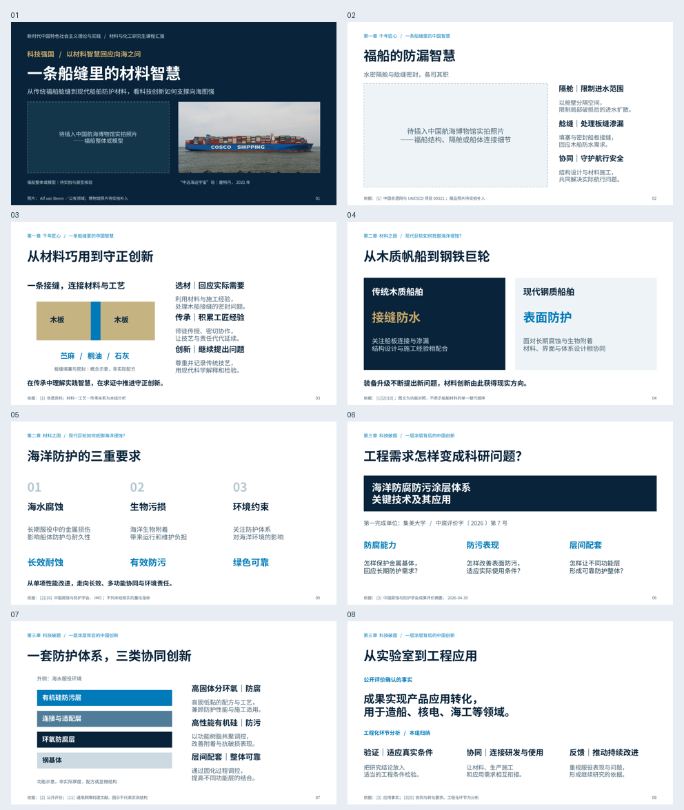
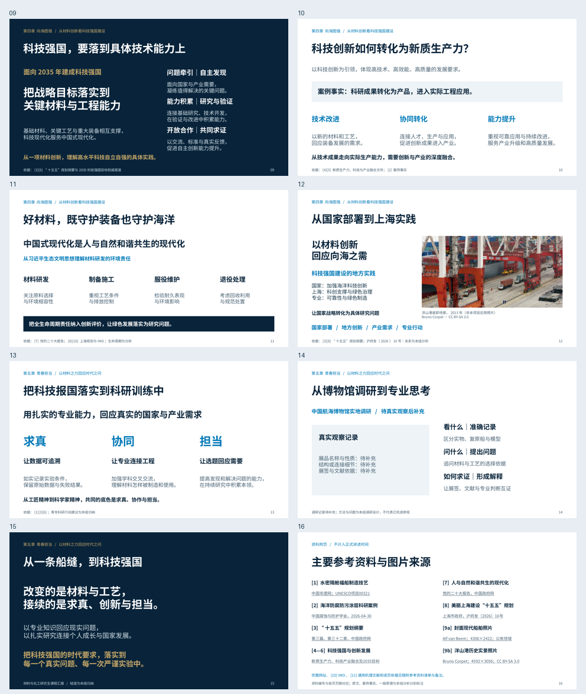

# 一条船缝里的材料智慧｜新中特课程完整汇报

已完成 **15页正式汇报＋1页参考资料附页**，16:9，计划讲述 **16分30秒**。内容依照最终五章提纲及最新修正，延续已确认V3样张的配色、字体和排版。**博物馆静态照片及真实调研记录仍待补充**；照片框与观察记录清楚标示，未虚构经历或展品身份。

## 直接下载

- [可编辑PPTX](https://github.com/zcb4fbrt2j-hue/lolping/raw/refs/heads/presentation/material-wisdom-full-course-report-20261025/presentations/material-wisdom-full-course-report-20261025/build/material-wisdom-full-course-report.pptx)：**6,684,734字节**
- [16页PDF](https://github.com/zcb4fbrt2j-hue/lolping/raw/refs/heads/presentation/material-wisdom-full-course-report-20261025/presentations/material-wisdom-full-course-report-20261025/build/material-wisdom-full-course-report.pdf)：**1,421,093字节**
- [完整交付包：PPTX、PDF、逐页PNG、原图、讲稿、源码、核验与说明](https://github.com/zcb4fbrt2j-hue/lolping/raw/refs/heads/presentation/material-wisdom-full-course-report-20261025/presentations/material-wisdom-full-course-report-20261025/material-wisdom-full-course-report-delivery.zip)
- [完整预览联系表](build/previews/contact-sheet.png)

PPTX为实际可编辑文件，不是整页图片或Git LFS指针。若GitHub显示文件页，点击右上角 **Download raw file** 下载；仅下载使用无需重新构建。

## 内容结构与时间

| 部分 | 页码 | 时间 |
|---|---|---|
| 封面与导言 | 1 | 0:30 |
| 第一章 千年匠心：一条船缝里的中国智慧 | 2—3 | 3:00 |
| 第二章 材料之困：现代巨轮如何抵御海洋侵蚀？ | 4—5 | 2:00 |
| 第三章 科技破题：一层涂层背后的中国创新 | 6—8 | 3:30 |
| 第四章 向海图强：从材料创新看科技强国建设 | 9—12 | 5:00 |
| 第五章 青春担当：以材料之力回应时代之问 | 13—15 | 2:30 |
| 主要参考资料与图片来源 | 16 | 备查，不讲述 |
| 合计 | 15页正式讲述 | **16:30** |

第四章把4.1与4.2合并到第9页，随后分别讨论新质生产力、生态文明和上海实践。第三章讲科研问题与公开成果事实，第四章解释国家战略与发展逻辑，不重复技术细节。

[已更新的逐页规划](逐页内容与版式规划.md) · [逐页讲稿](逐页讲稿.md) · [参考资料与图片来源](参考资料与图片来源.md) · [照片替换与使用说明](照片替换与使用说明.md)

讲稿正文约 **4,036个汉字**，实际时间需按个人语速、停顿排练。全部讲述正文同时写入各页演讲者备注，完整来源与编辑提示另作标示。

## 全部逐页预览





所有单页PNG均为 **1920×1080**。为避免PDF物理尺寸舍入带来1像素差异，使用LibreOffice导出的PDF及Poppler明确指定输出尺寸栅格化；PPT中的照片保持原始分辨率和等比裁剪。

| 页码 | PNG预览 | 实际大小（字节） |
|---|---|---:|
| 01 | [一条船缝里的材料智慧](build/previews/slide-01.png) | 495,280 |
| 02 | [福船的防漏智慧](build/previews/slide-02.png) | 184,429 |
| 03 | [从材料巧用到守正创新](build/previews/slide-03.png) | 201,582 |
| 04 | [从木质帆船到钢铁巨轮](build/previews/slide-04.png) | 168,684 |
| 05 | [海洋防护的三重要求](build/previews/slide-05.png) | 166,631 |
| 06 | [工程需求怎样变成科研问题？](build/previews/slide-06.png) | 165,131 |
| 07 | [一套防护体系，三类协同创新](build/previews/slide-07.png) | 187,272 |
| 08 | [从实验室到工程应用](build/previews/slide-08.png) | 186,163 |
| 09 | [科技强国，要落到具体技术能力上](build/previews/slide-09.png) | 249,412 |
| 10 | [科技创新如何转化为新质生产力？](build/previews/slide-10.png) | 202,833 |
| 11 | [好材料，既守护装备也守护海洋](build/previews/slide-11.png) | 189,736 |
| 12 | [从国家部署到上海实践](build/previews/slide-12.png) | 1,043,184 |
| 13 | [把科技报国落实到科研训练中](build/previews/slide-13.png) | 188,662 |
| 14 | [从博物馆调研到专业思考](build/previews/slide-14.png) | 179,305 |
| 15 | [从一条船缝，到科技强国](build/previews/slide-15.png) | 162,097 |
| 16 | [主要参考资料与图片来源](build/previews/slide-16.png) | 223,257 |

## 可编辑性与照片

- **214个非空原生可编辑文字对象**，功能示意、普通图形与照片预留框均为PowerPoint原生元素。
- 第1页福船整体照片框为 **2:1**；第2页结构/隔舱/连接细节框为 **16:9**。使用原生矩形和独立标签，非背景图片，也非带插入图标的母版占位符。精确坐标见 `photo-placeholders.json`。
- 第14页为“待真实观察后补充”的记录区；没有预写参观、采访或实测结论。
- 封面中远海运宇宙轮照片：**4306×2422**，Alf van Beem，公有领域；正文第12页洋山港照片：**4592×3056**，Bruno Corpet，CC BY-SA 3.0，明确为2013年历史场景、非本项目应用照片。
- 封面照片及其裁剪、调色、缩放衍生图禁止进入正文；洋山港图只使用一次。原始JPEG按字节保留，图像未放大、补画或AI生成。

## 核验

- PPTX ZIP CRC及全部XML/关系文件可解析；16页、16:9。所有讲稿正文均与备注一致；两张照片独立嵌入，原始字节与已核验素材哈希一致，裁剪后比例正确。
- LibreOffice完整渲染16页，PDF可解析，所用中文字体字形已嵌入；逐页PNG及完整联系表已检查。
- 自动QA：**0文字溢出、0图文重叠、0几何错误、0视觉警告、0设计警告、0视觉复核警告**。保留第1、2、4页共3条面积密度提示；照片框/背景板及内部文字叠加计入面积，人工复核未见可见拥挤或碰撞。
- 主代理与独立视觉复核完成源文件修正和复验，见 `build/qa/manual-review.md`；自动结果见 `build/qa/qa_report.json`；文件字节数与SHA-256见 `build/integrity.json`、`SHA256SUMS.json`。
- 已存原文与本次5个官方页面复核支持案例和政策；原文、项目事实、通用机理及本组分析分开。未混用2025年同类案例数据，未编造寿命、应用船名、减排比例或宏观贡献。
- 241份既有文件哈希未变，包括原始15页、V2、V3、既有照片与coursework-ppt，见 `preservation-check.json`。本次不搜索传统福船照片。

## 源码与重建

本次直接阅读并遵循 `.agents/skills/coursework-ppt/SKILL.md` 和 `.agents/skills/presentation-skill/SKILL.md`，不声称网页版已自动识别。

规范源文件为 `outline.json`、设计/内容/证据/素材计划、讲稿与备注。使用Skill标准 `scripts/build_deck_pptxgenjs.js`，新增可选 `course_report.js` 模板，复用已有 `museum_editorial.js`；原有V2/V3模板未改动。QA新增自定义版式的真实构图分类，不修改通用检查阈值。模板与接入补丁副本及Apache-2.0许可证保存在 `source/`。

在本GitHub分支、已有依赖环境中执行：

```bash
bash presentations/material-wisdom-full-course-report-20261025/rebuild.sh
```

重建只更新当前新版本目录的构建产物。下载的ZIP需放在含已安装Skill的当前项目中使用重建脚本；不是打包了所有运行时依赖的独立离线应用。依赖沿用Node.js与Skill现有npm包，Python的pptx/Pillow/lxml/PyMuPDF，LibreOffice和Poppler，本次没有重新安装依赖。

后续静态照片可按说明手动插入，或用 `replace_museum_photos.py` 更新结构化源码并输出到新目录。该脚本不改旧版PPT；新素材仍需人工核实清晰度、展品身份和使用范围。

## GitHub分支

`presentation/material-wisdom-full-course-report-20261025`

[创建Pull Request，目标main](https://github.com/zcb4fbrt2j-hue/lolping/compare/main...presentation/material-wisdom-full-course-report-20261025?expand=1)

分支承接此前V3及图片核验历史；本次新增完整汇报与修正后的规划，不覆盖此前PPT。无需合并即可从本分支下载完整文件。
