# 《一条船缝里的材料智慧》少字图文精修版

基于 `material-wisdom-visual-polish.pptx` 的同一套PPT小幅精修，保存为新版本。**原文件及此前所有样张不变。** 仍为15页讲述＋1页参考资料，五章与16分30秒安排不变。

- [下载可编辑PPTX](build/material-wisdom-photo-light.pptx?raw=1)：22,157,629字节。
- [下载PDF](build/material-wisdom-photo-light.pdf?raw=1)：2,811,559字节。
- [全部文件交付ZIP](material-wisdom-photo-light-delivery.zip?raw=1)：PPTX、PDF、16张PNG、讲稿、来源、占位清单和生成源码。
- [16张PNG单独打包](material-wisdom-photo-light-previews.zip?raw=1)。
- [图片占位清单与替换说明](图片占位清单与替换说明.md)。
- [前后对照：第6、10、13、14页](build/previews/before-after-key-slides.png)。
- [完整科研、理论和图片来源](参考资料与图片来源.md)。

如GitHub显示大文件无法预览，点击 **Raw / Download raw file**；不要保存GitHub网页本身。文件不足GitHub单文件100MiB限制，下载后可直接在PowerPoint中编辑。

## 本轮改动

保持深海蓝、白、金的风格与已核实内容；第2—15页主体汉字由1318减为800，减少约39.3%（统计排除标题、章节眉、页脚、照片署名与占位提示）。完整原讲稿逐字保留，原备注原样保留并补入此前页面长解释，科研事实与理论观点没有因上屏减量而丢失。

保留5张原始高清真实照片；封面照片只用一次。本轮没有继续图片检索，也没有添加来源不明的图片。第7页仍为可编辑的功能层示意，明确不表示实际厚度、配方或显微结构。第四章仍突出科技强国、高水平科技自立自强、新质生产力、生态文明与中国式现代化。

| 页码 | 待补照片 | 横向比例 |
|---|---|---|
| 1 | 中国航海博物馆：身份明确的福船整体或模型，封面独占 | 2:1 |
| 2 | 博物馆：福船结构、隔舱或船体连接细节 | 16:9 |
| 6 | 身份明确的海洋防护涂层制备、测试等科研实景 | 16:10 |
| 10 | 产学研协同、工艺验证或涂装生产现场 | 16:10 |
| 13 | 本组规范实验、科研记录或协作研究实拍 | 3:2 |
| 14 | 博物馆展品与展签或真实调研观察现场 | 16:9 |

六处均为**原生图片占位符**。插入照片后删除对应 `_LABEL` 可编辑提示即可，位置、大小和裁剪比例预先设好。推荐原图宽≥1920px、优先≥3000px；使用独立原片，不重复封面。照片及图注需要真实身份、地点、日期、摄影者和授权说明。第14页不代表已经参观。第6、10、13页的一般场景照片不得标作科研案例团队、结果或应用证明。

## 预览

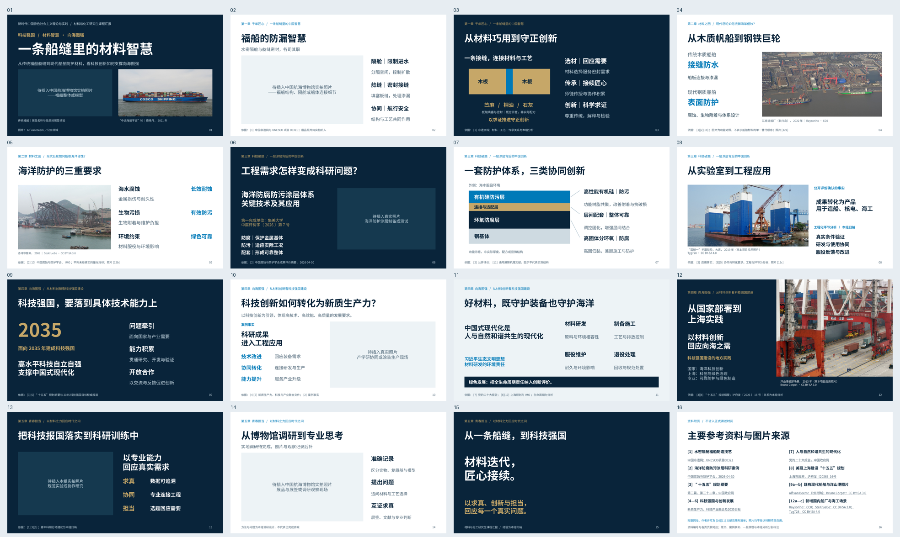

[前8页大图](build/previews/preview-01-08.png) · [后8页大图](build/previews/preview-09-16.png)

### 第1页

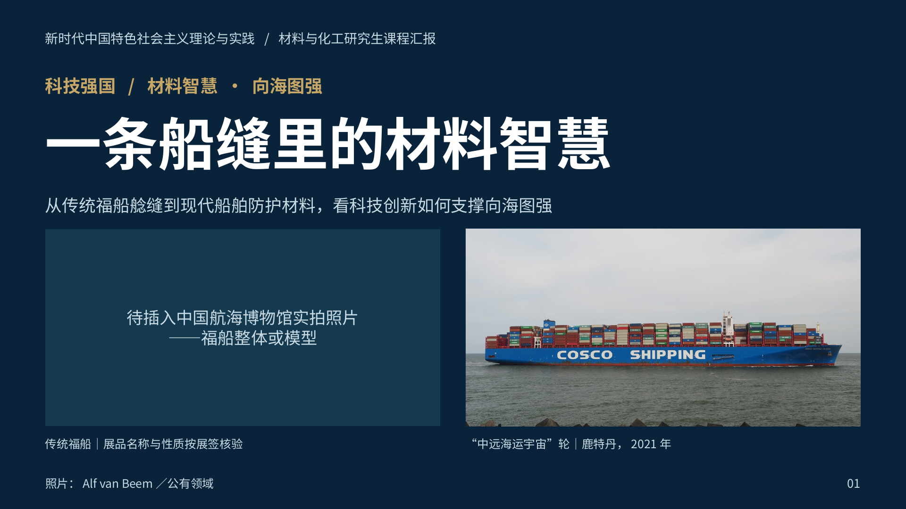

[下载原尺寸PNG](build/previews/slide-01.png?raw=1)

### 第2页

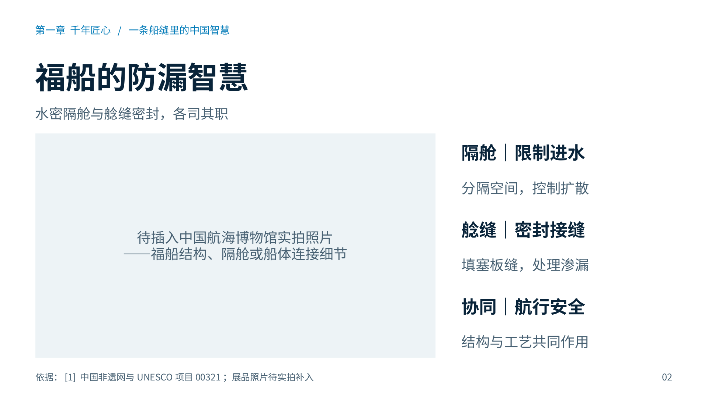

[下载原尺寸PNG](build/previews/slide-02.png?raw=1)

### 第3页

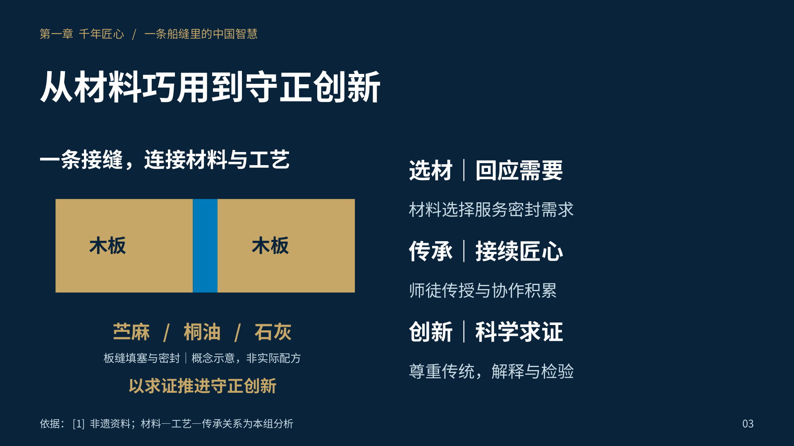

[下载原尺寸PNG](build/previews/slide-03.png?raw=1)

### 第4页

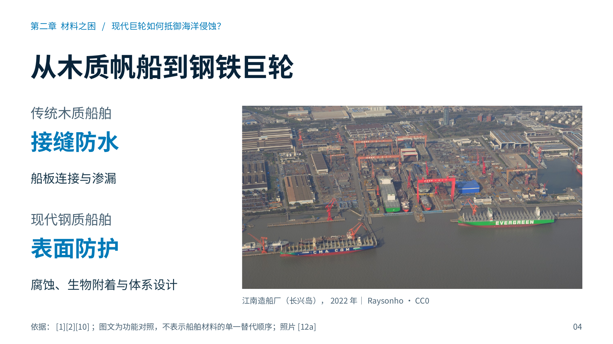

[下载原尺寸PNG](build/previews/slide-04.png?raw=1)

### 第5页

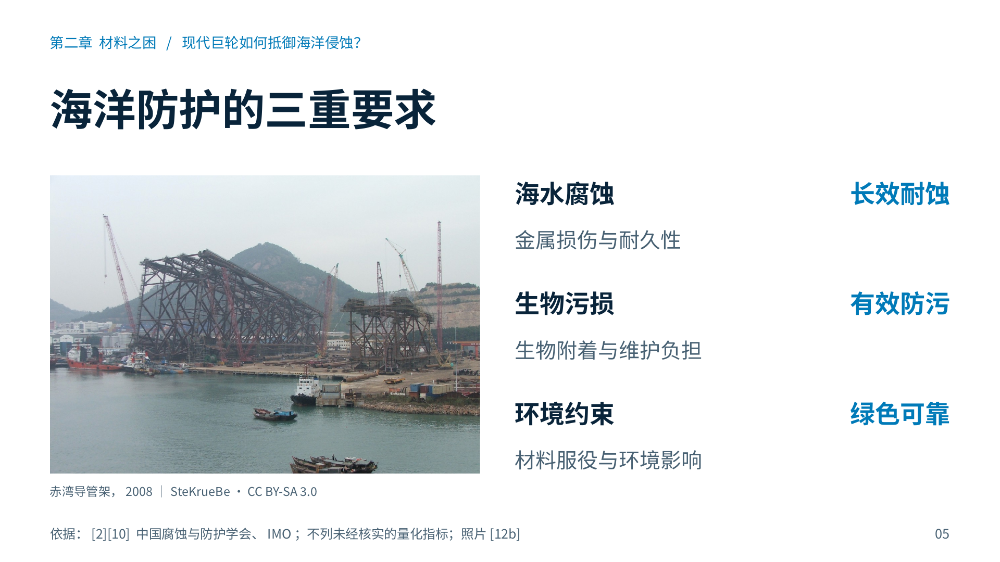

[下载原尺寸PNG](build/previews/slide-05.png?raw=1)

### 第6页

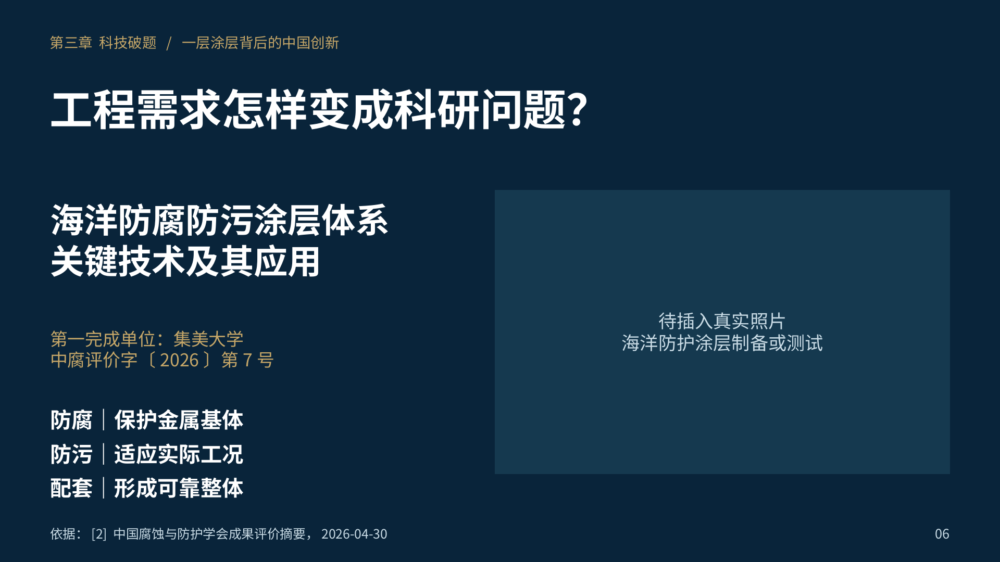

[下载原尺寸PNG](build/previews/slide-06.png?raw=1)

### 第7页

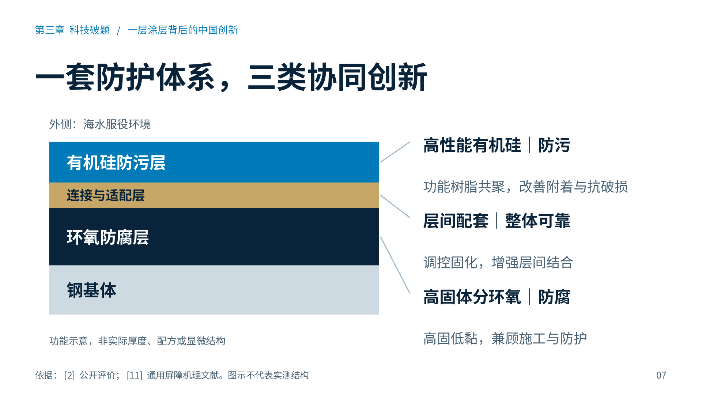

[下载原尺寸PNG](build/previews/slide-07.png?raw=1)

### 第8页

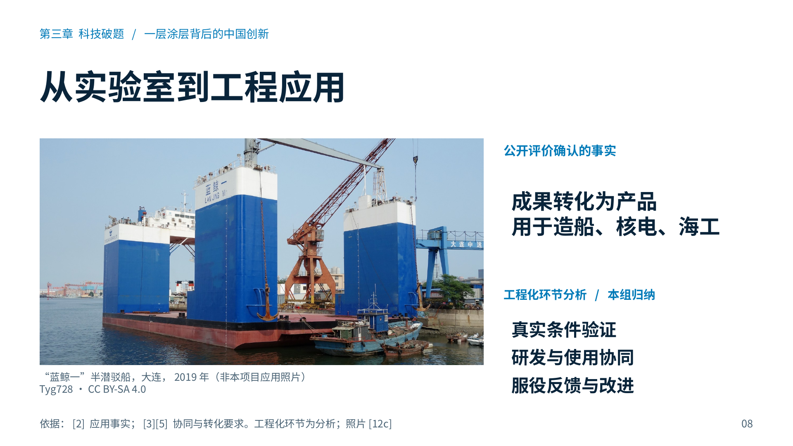

[下载原尺寸PNG](build/previews/slide-08.png?raw=1)

### 第9页

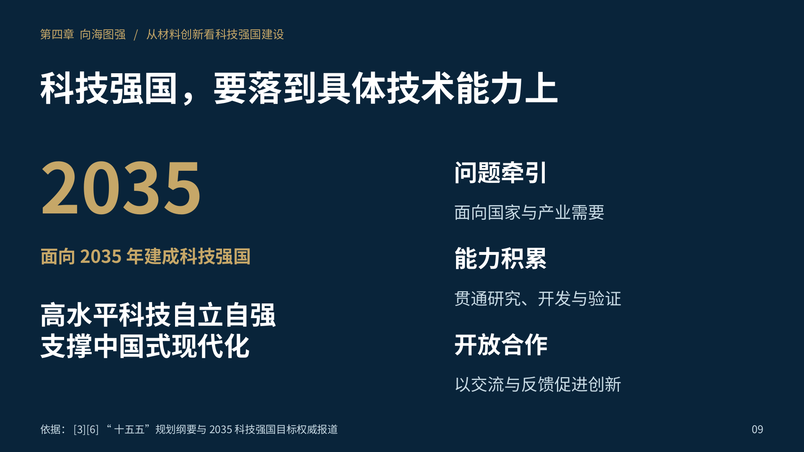

[下载原尺寸PNG](build/previews/slide-09.png?raw=1)

### 第10页

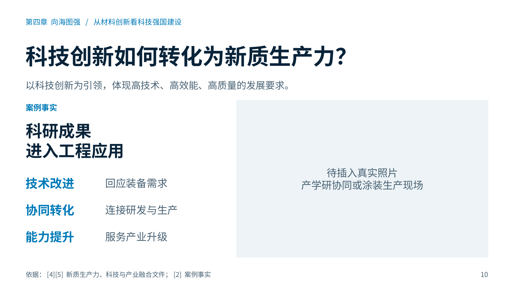

[下载原尺寸PNG](build/previews/slide-10.png?raw=1)

### 第11页

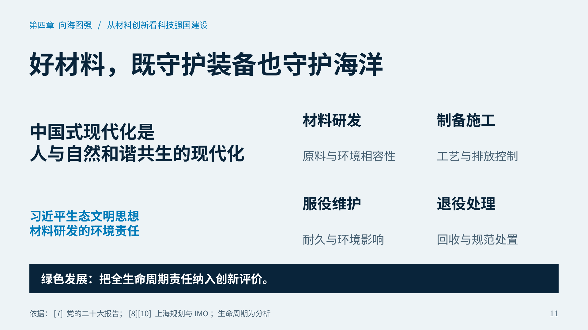

[下载原尺寸PNG](build/previews/slide-11.png?raw=1)

### 第12页

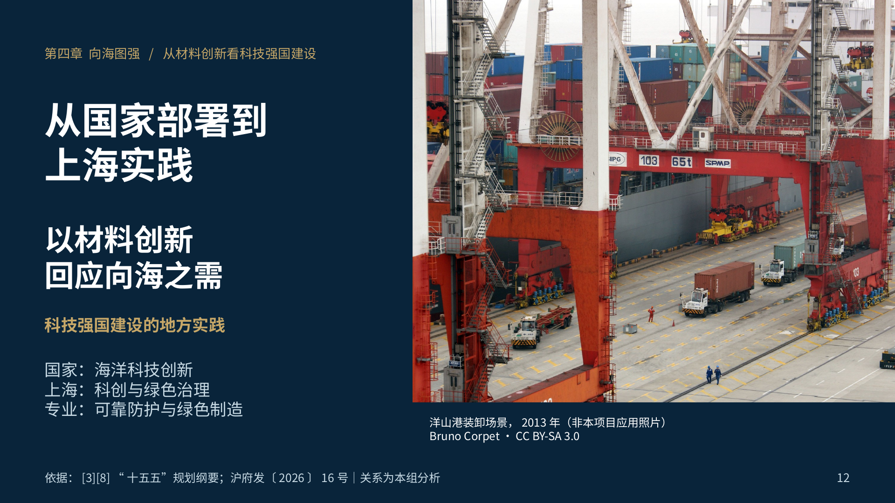

[下载原尺寸PNG](build/previews/slide-12.png?raw=1)

### 第13页

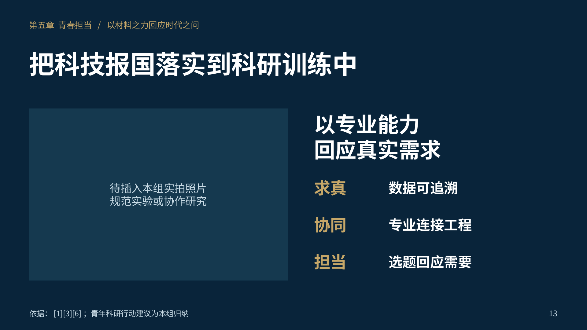

[下载原尺寸PNG](build/previews/slide-13.png?raw=1)

### 第14页

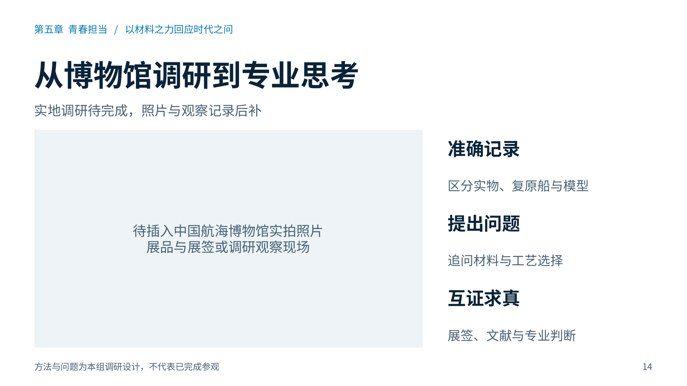

[下载原尺寸PNG](build/previews/slide-14.png?raw=1)

### 第15页

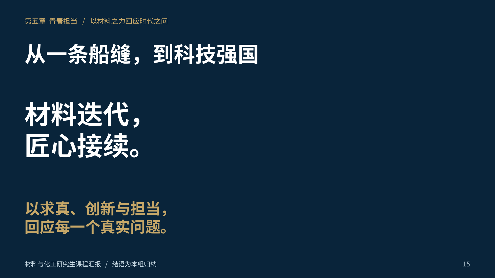

[下载原尺寸PNG](build/previews/slide-15.png?raw=1)

### 第16页

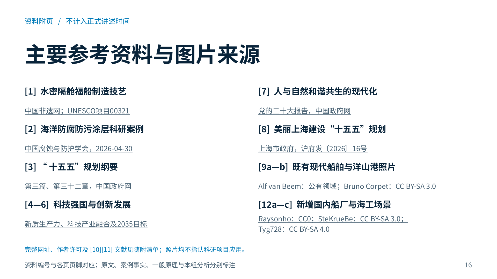

[下载原尺寸PNG](build/previews/slide-16.png?raw=1)

## 验证和使用

- LibreOffice渲染全部16页；PDF为16页，PNG全部1920×1080；PDF嵌入Noto Sans CJK SC字体。
- PPTX ZIP/XML完整；200个有字的原生可编辑文本对象，5张原始高清照片，6处原生图片占位符。图片按比例裁剪，没有拉伸或放大像素。
- 六处占位分别完成插图、另存、重新打开测试，几何尺寸不变；该测试只使用/tmp副本，交付版没有填入测试图。实际Windows/Mac PowerPoint界面尚未人工操作验证。
- 自动检查0溢出、0重叠、0几何错误、0视觉警告、0设计警告、0视觉复核警告。4条面积密度提示非阻塞，人工核对未见拥挤；没有关闭相关检查。
- 独立复核两轮逐页查看原尺寸PNG，修改后通过；见[QA说明](build/qa/manual-review.md)和[完整性记录](build/integrity.json)。
- 454个此前文件哈希不变；原版15页、V2/V3、上一视觉版、所有既有素材和coursework-ppt均保留。

先下载PPTX另存副本，再按[替换说明](图片占位清单与替换说明.md)补图。字体建议安装Noto Sans CJK SC；PDF预览已嵌入字体。手工修改后的PPTX另存独立文件；直接运行源码重建会依据outline恢复源设计，不会读取手工编辑结果。

## 源码与重建

`outline.json` 为规范源内容，`editorial.screen` 为本轮上屏精简文本；原完整内容与演讲者备注保留。新模板及原生占位序列化器见 `source/`，集成入口在本仓库 `.agents/skills/presentation-skill/`。生成与QA使用已有依赖，未重装Skill。

```bash
bash presentations/material-wisdom-photo-light-20261025/rebuild.sh
```

需本仓库及已安装的presentation-skill、Node.js、PptxGenJS、Python依赖、LibreOffice与Poppler。源模块沿用Apache-2.0许可，照片按单独来源许可。独立ZIP不包含整个Skill运行时；在本分支仓库中重建。

ZIP为减少重复存储，省略了已原样嵌入PPTX的5份单独JPEG和重复QA渲染JPG。原始JPEG全部在GitHub的 `assets/`，也可运行 `python restore_photo_assets.py` 按SHA-256从PPTX无损恢复。PPTX、PDF及PNG下载和查看无需运行脚本。
