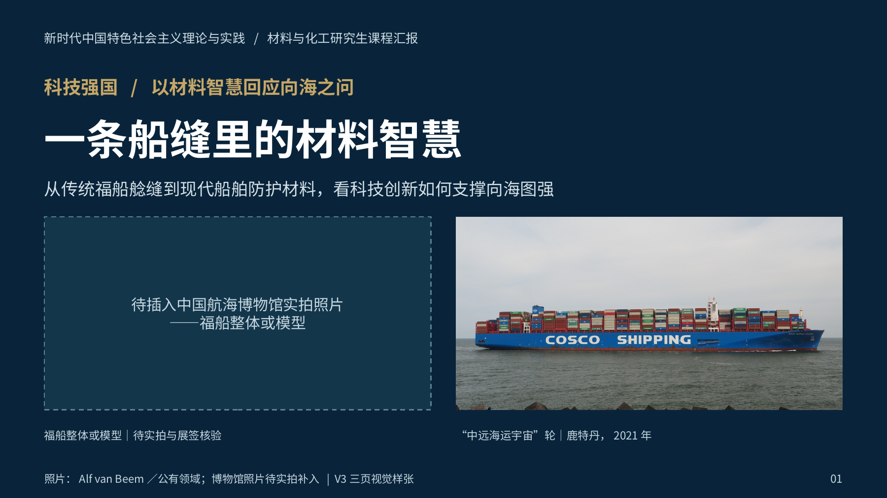
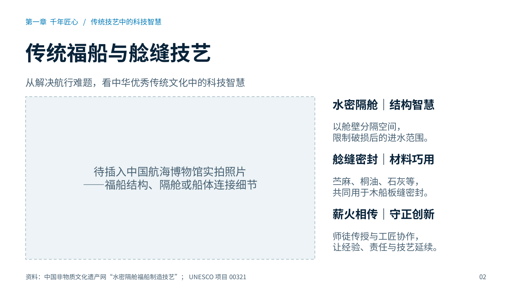
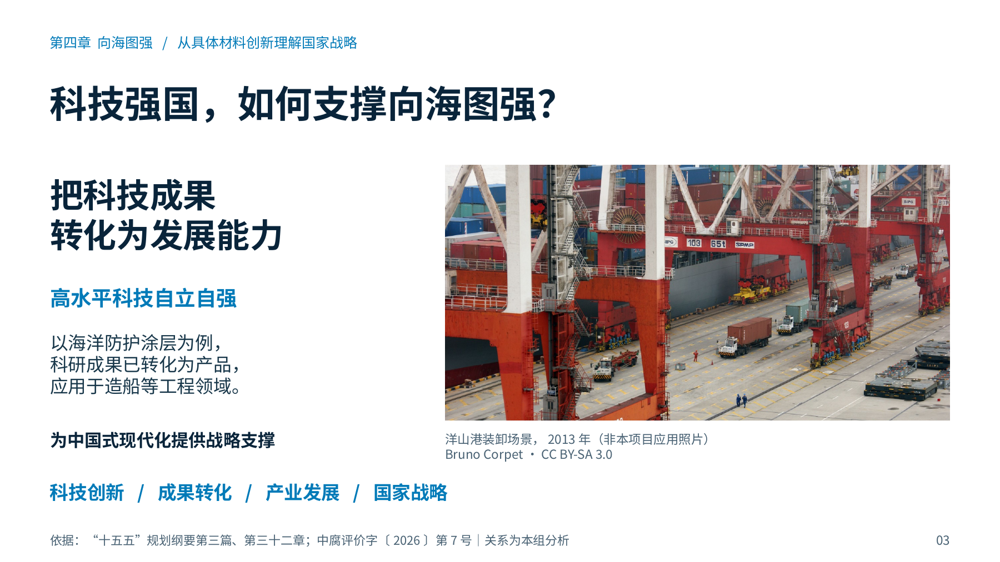

# 一条船缝里的材料智慧｜V3三页视觉样张（博物馆实拍预留版）

已完成 **3页可编辑PPTX、3页PDF和3张PNG**，没有制作其余12页。传统福船照片按2026-10-25用户最新决定预留，等待中国航海博物馆实拍；不声称照片已经补齐。原始15页、V2、既有V3检索素材和 coursework-ppt 保持不变。

## 下载

- [可编辑PPTX（推荐直接下载）](https://github.com/zcb4fbrt2j-hue/lolping/raw/refs/heads/redesign/material-wisdom-v3-museum-placeholders-20261025/presentations/material-wisdom-v3-museum-placeholders/build/material-wisdom-v3-museum-placeholders.pptx)
- [PDF预览](https://github.com/zcb4fbrt2j-hue/lolping/raw/refs/heads/redesign/material-wisdom-v3-museum-placeholders-20261025/presentations/material-wisdom-v3-museum-placeholders/build/material-wisdom-v3-museum-placeholders.pdf)
- [完整交付包：PPTX、PDF、PNG、原图、源码与说明](https://github.com/zcb4fbrt2j-hue/lolping/raw/refs/heads/redesign/material-wisdom-v3-museum-placeholders-20261025/presentations/material-wisdom-v3-museum-placeholders/material-wisdom-v3-delivery.zip)
- [三页预览总览](build/previews/contact-sheet.png)

若GitHub直接链接在浏览器内预览，使用文件页右上角 **Download raw file** 下载。PPTX是实际文件，不是Git LFS指针。

## 三页内容

1. 深海蓝封面：传统福船大图预留框与高清“中远海运宇宙”轮照片双视觉；科技强国主题明确。
2. 传统福船与艌缝技艺：16:9大图预留框，加水密隔舱、艌缝材料、传承与守正创新的简洁解读；不将未知照片预称艌缝现场。
3. 科技强国如何支撑向海图强：以已核实的涂层成果产品转化为实例，联系高水平科技自立自强、产业发展和中国式现代化；配独立洋山港2013年历史实景，明确不是本项目应用照片。

三页分别是封面、第一章和第四章的视觉样张，不是完整汇报的连续前三页。五章内容框架保持为后续扩展依据。

## 预览







## 占位框和来源

| 页码 | 建议实拍内容 | 裁剪比例 |
|---|---|---|
| 1 | 身份明确的福船实物、现代复原船或模型整体横向照片 | **2:1** |
| 2 | 另一张独立原片：结构、隔舱或船体连接细节 | **16:9** |

两个照片区均为原生矩形与独立标签，可编辑、可删除；不是不可编辑背景，也不是母版图片占位符。位置、精确尺寸、原片要求和操作步骤见[图片占位框与替换说明](图片占位框与替换说明.md)及 `photo-placeholders.json`。

原图分辨率与内容核验、使用许可、来源网址及参考资料见[图片与资料来源](图片与资料来源.md)、`image-sources.json`、`assets/attribution.csv`和各页演讲者备注。封面与正文照片不同，封面所有照片及衍生图禁止在后续12页复用。

## 实际文件大小（字节）

| 文件 | 大小 |
|---|---:|
| `build/material-wisdom-v3-museum-placeholders.pptx` | 6,420,426 |
| `build/material-wisdom-v3-museum-placeholders.pdf` | 825,006 |
| `build/previews/slide-01.png` | 453,553 |
| `build/previews/slide-02.png` | 189,536 |
| `build/previews/slide-03.png` | 934,882 |
| `build/previews/contact-sheet.png` | 628,723 |

完整SHA-256见 `build/integrity.json` 和 `SHA256SUMS.json`；打包文件大小由交付时实际统计，不以估计值代替。

## 验证

- PPTX ZIP CRC及全部XML可解析；3页、16:9，**31个非空原生可编辑文字对象**，2张高清照片独立嵌入。
- 两个原生照片框的位置/尺寸/文字已检查；照片经裁剪后的有效比例与显示框一致，无拉伸；没有封面照片正文复用。
- LibreOffice渲染全部3页，PNG为1800×1013（16:9像素取整）；PDF为3页，可解析并已嵌入中文字体字形。
- 源码修复并重新渲染后，0溢出、0重叠、0视觉警告、0设计警告、0视觉复核警告。保留2条面积密度提示，来自照片框及其内部标签面积的重复计入；逐页人工复验确认不构成拥挤或碰撞。
- 人工视觉复核记录见 `build/qa/manual-review.md`；自动报告见 `build/qa/qa_report.json`；完整性见 `build/integrity.json`。
- 187份既有文件的内容哈希未变，见 `preservation-check.json`。本次没有访问失败的传统福船图片网站，没有修改正式15页或V2。

## 源码与重建

本次直接阅读并遵循已安装的 `.agents/skills/coursework-ppt/SKILL.md` 与 `.agents/skills/presentation-skill/SKILL.md`，不声称网页版已自动识别。

规范源文件为 `outline.json`、设计/内容/证据/素材计划和 `notes.md`；构建仍使用Skill的标准 `scripts/build_deck_pptxgenjs.js`。新增可选模板 `.agents/skills/presentation-skill/templates/pptxgenjs/museum_editorial.js`，不改变已有V2模板。交付包的 `source/` 附模板副本、标准构建器接入补丁及原Skill许可证；模板继承Apache-2.0。

在当前仓库、已有依赖环境中：

```bash
bash presentations/material-wisdom-v3-museum-placeholders/rebuild.sh
```

这会重新生成本V3目录的构建产物；首次交付文件已经生成，**仅下载使用无需重建**。更新实拍照片请使用 `replace_museum_photos.py` 生成新目录，保留本版。构建依赖为Node.js和Skill现有npm依赖、Python及现有pptx/Pillow/lxml/PyMuPDF、LibreOffice与Poppler；没有重新安装依赖。

## GitHub

工作分支：`redesign/material-wisdom-v3-museum-placeholders-20261025`，目标分支为 `main`。

[创建Pull Request](https://github.com/zcb4fbrt2j-hue/lolping/compare/main...redesign/material-wisdom-v3-museum-placeholders-20261025?expand=1)

此分支继承此前V2和图片核验分支以保留可追溯素材；本次新增提交只包含V3预留版和可选模板接入，未覆盖旧文件。
