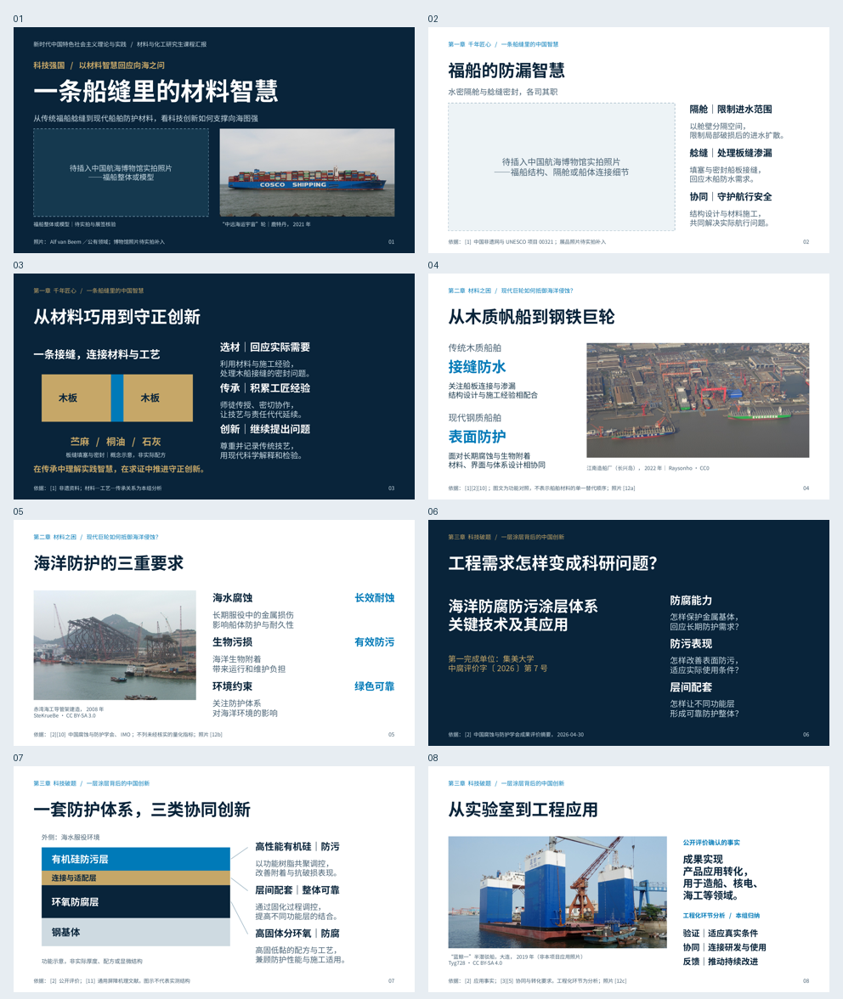
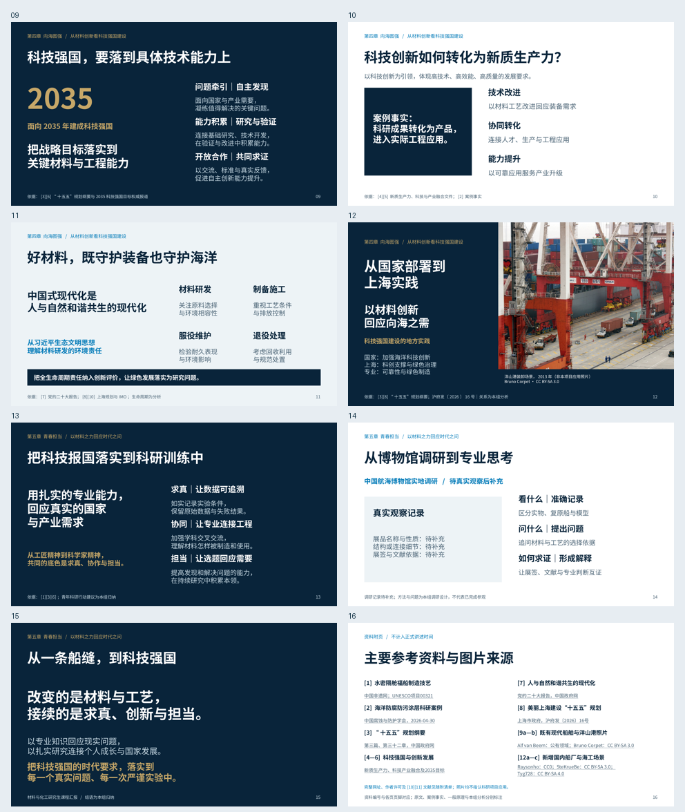

# 一条船缝里的材料智慧｜独立视觉精修版

保留已确认的**五章、15页正式汇报＋1页参考资料附页、16分30秒讲述安排**。科研事实、理论和原有出处不变；原讲稿文件按字节保留，原备注逐页完整保留于新备注开头。主要变化是字号、构图、深浅节奏、专业示意与真实摄影，详见[逐页精修说明](视觉精修逐页说明.md)。

## 下载

- [可编辑PPTX](https://github.com/zcb4fbrt2j-hue/lolping/raw/refs/heads/presentation/material-wisdom-visual-polish-20261025/presentations/material-wisdom-visual-polish-20261025/build/material-wisdom-visual-polish.pptx)：**22,144,800字节**
- [16页PDF](https://github.com/zcb4fbrt2j-hue/lolping/raw/refs/heads/presentation/material-wisdom-visual-polish-20261025/presentations/material-wisdom-visual-polish-20261025/build/material-wisdom-visual-polish.pdf)：**2,895,640字节**
- [交付包：PPTX、PDF、PNG、源码、讲稿、资料与说明](https://github.com/zcb4fbrt2j-hue/lolping/raw/refs/heads/presentation/material-wisdom-visual-polish-20261025/presentations/material-wisdom-visual-polish-20261025/material-wisdom-visual-polish-delivery.zip)
- [四个重点页面的精修前后对照](build/previews/before-after-key-slides.png)
- [全部16页联系表](build/previews/contact-sheet.png)

文件不使用Git LFS；在GitHub文件页点击 **Download raw file** 即可取得原文件。下载使用PPTX无需重建。

## 视觉变化

- 封面主标题从34pt增至44pt，深海蓝、白、科技蓝与少量金色保持。
- 取消原来的连续三栏文字组织；工程摄影、纵向解读、案例色块、功能层示意与深浅页面交错。
- 第三章涂层功能层连贯显示，界面与引线关系更清楚；全部为原生可编辑形状，并注明非实际厚度、配方或显微结构。
- 第四章四页分别采用目标与能力、事实与转化层次、引文与生命周期、上海大幅实景；保留科技强国、高水平科技自立自强、新质生产力、生态文明和中国式现代化的原论证。
- 新增3张国内船厂/海工场景，未使用无关实验室或设备照片替代科研成果。全部照片各用一次，封面照片不进入正文。
- 全稿页脚上移0.10英寸；消除拆词、孤字尾行与图片注释边缘残条，增强投影可读性。

## 全部逐页预览





| 页码 | 1920×1080 PNG |
|---|---|
| 1 | [一条船缝里的材料智慧](build/previews/slide-01.png) |
| 2 | [福船的防漏智慧](build/previews/slide-02.png) |
| 3 | [从材料巧用到守正创新](build/previews/slide-03.png) |
| 4 | [从木质帆船到钢铁巨轮](build/previews/slide-04.png) |
| 5 | [海洋防护的三重要求](build/previews/slide-05.png) |
| 6 | [工程需求怎样变成科研问题？](build/previews/slide-06.png) |
| 7 | [一套防护体系，三类协同创新](build/previews/slide-07.png) |
| 8 | [从实验室到工程应用](build/previews/slide-08.png) |
| 9 | [科技强国，要落到具体技术能力上](build/previews/slide-09.png) |
| 10 | [科技创新如何转化为新质生产力？](build/previews/slide-10.png) |
| 11 | [好材料，既守护装备也守护海洋](build/previews/slide-11.png) |
| 12 | [从国家部署到上海实践](build/previews/slide-12.png) |
| 13 | [把科技报国落实到科研训练中](build/previews/slide-13.png) |
| 14 | [从博物馆调研到专业思考](build/previews/slide-14.png) |
| 15 | [从一条船缝，到科技强国](build/previews/slide-15.png) |
| 16 | [主要参考资料与图片来源](build/previews/slide-16.png) |

## 真实照片及许可

| 页码 | 原始来源页 | 原片像素 | 许可 |
|---|---|---|---|
| 1 | [cosco-universe](https://commons.wikimedia.org/wiki/File:Cosco_Shipping_Universe_(ship,_2018)_IMO_9795610,_Port_of_Rotterdam_pic7.JPG) | 4306×2422 | Public domain |
| 12 | [yangshan-port](https://commons.wikimedia.org/wiki/File:Shanghai-Yangshan-Port-Containers2013-03.JPG) | 4592×3056 | CC BY-SA 3.0 |
| 4 | [jiangnan-shipyard](https://commons.wikimedia.org/wiki/File:JiangnanShipyardChangxingIsland.jpg) | 4928×3264 | CC0 |
| 5 | [chiwan-jacket](https://commons.wikimedia.org/wiki/File:Jacket_of_oil_platform_at_Shipyard_Chiwan.jpg) | 2272×1704 | CC BY-SA 3.0 |
| 8 | [lan-jing-yi](https://commons.wikimedia.org/wiki/File:LAN_JING_YI_at_Dalian_Shipyard_20190617.jpg) | 2700×1800 | CC BY-SA 4.0 |

新图为江南造船厂长兴岛厂区2022年实景、赤湾海工导管架2008年建造场景、蓝鲸一半潜驳船2019年大连场景。其身份、拍摄对象、日期、作者、原图URL、许可与字节哈希见 `image-sources.json` 和[参考资料清单](参考资料与图片来源.md)。所有场景图均不指认案例涂层项目应用；洋山港照片保持2013年历史时点说明。

原始JPEG未放大、调色、补画或AI生成；只在PPT内作等比裁剪。CC BY-SA照片的裁剪呈现部分保留原许可、作者与来源。低清焊接照片、夜间噪声较大的航拍和内容不匹配的实验室候选已排除，记录见 `sources/new-image-research.json`。没有重新搜索传统福船照片。

## 仍待实拍补充

第1页福船整体/模型照片框为 **2:1**，第2页结构/隔舱/连接细节框为 **16:9**，均为原生矩形和独立可编辑标签。第14页真实调研记录保持待补充，不虚构经历或展品身份。

封面照片框坐标为X=0.5、Y=2.53、宽4.36、高2.18英寸；第2页原框位保持。具体操作与元数据要求见[照片替换说明](照片替换与使用说明.md)和 `photo-placeholders.json`。补图后仍需检查展签身份、主体裁剪与图片使用范围。

## 检查结果

- PPTX ZIP及全部XML可解析，16:9；**202个非空原生可编辑文字对象**，5张高清照片独立嵌入。
- LibreOffice完整渲染16页，PDF可解析，中文字体字形已嵌入；PNG全部1920×1080，主代理及独立fresh-eyes复核逐页检查。
- 源码修复后：**0文字溢出、0重叠、0几何错误、0视觉/设计/视觉复核警告**。保留3条面积密度提示，来自照片预留框与功能层内部文字面积叠加；人工复核未见可见拥挤。记录见 `build/qa/manual-review.md` 和 `qa_report.json`。
- 五章标题、页序、时间与原有事实字段保留；原稿及旧样张共345份文件哈希不变。见 `content-preservation.json`、`preservation-check.json`。原讲稿也保留在本目录，按字节与原完整版一致。
- 照片原片字节、等比裁剪、封面独占规则、备注与源码一致性通过检查；完整性见 `build/integrity.json` 和 `SHA256SUMS.json`。
- 仅验证当前LibreOffice环境，未声称已在Windows PowerPoint实机测试。博物馆静态照片和第14页真实记录仍待补入。

## 源码、交付包与重建

使用已安装的 `presentation-skill` 标准构建器与新增可选模板 `visual_polish.js`；旧版模板不改。`source/` 保存模板副本、构建器/QA接入补丁和Apache-2.0许可证。JSON源文件、讲稿、证据清单和可编辑图形均在当前目录；未重新安装依赖。

交付ZIP为减少重复，**不重复存放已经完整嵌入PPTX的5张原片，也不附重复的QA渲染JPEG**；照片无损保存在PPTX中，GitHub分支的 `assets/` 也提供全部原片。运行以下脚本可按SHA-256提取还原原片，已在独立临时目录验证5张完整还原：

```bash
python presentations/material-wisdom-visual-polish-20261025/restore_photo_assets.py
bash presentations/material-wisdom-visual-polish-20261025/rebuild.sh
```

重建在当前仓库及已安装Skill依赖中运行。`rebuild.sh`会先还原/校验原片，再构建和检查本新目录的产物。仅下载使用无需重建。后续博物馆照片继续可通过 `replace_museum_photos.py` 生成新目录替换；不会改旧PPT。

工作分支：`presentation/material-wisdom-visual-polish-20261025`。

[创建Pull Request，目标main](https://github.com/zcb4fbrt2j-hue/lolping/compare/main...presentation/material-wisdom-visual-polish-20261025?expand=1)。无需合并即可下载本分支文件。
